## CI: Personal Tracking Technologies Questionnaire {.smaller}
::: {layout-ncol=2}

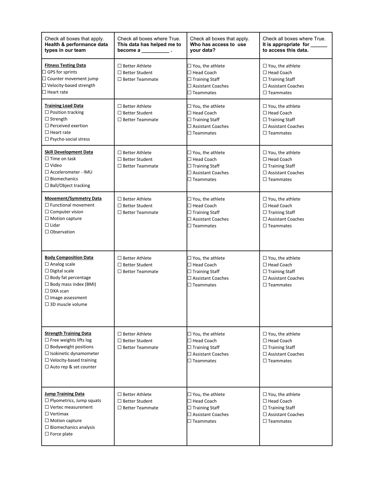{.lightbox}

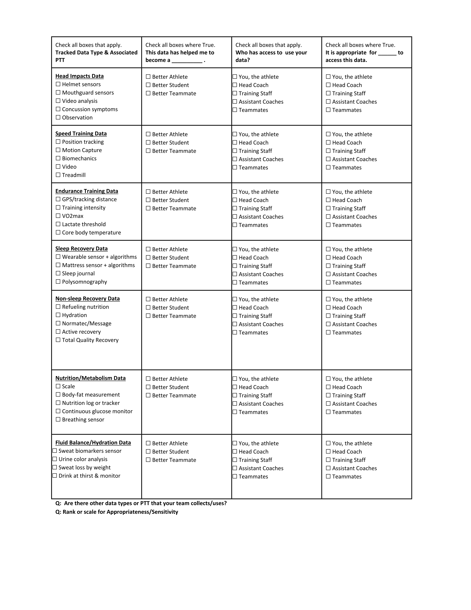{.lightbox}

:::

## PTTQ Results

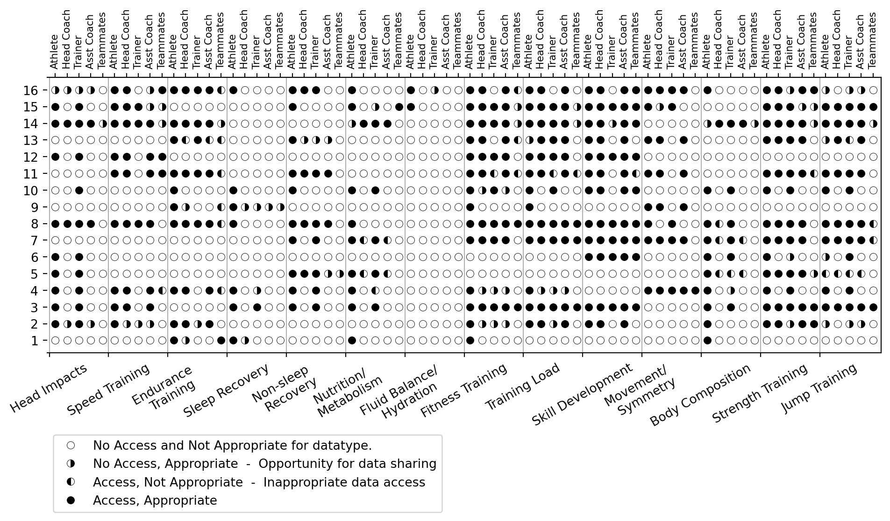{.lightbox}

## PTTQ Information Flows

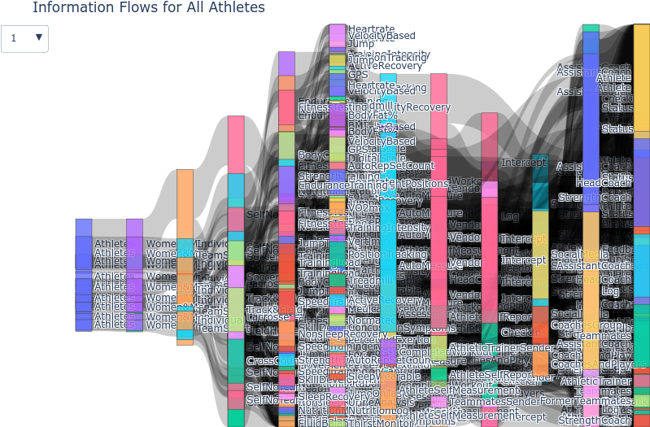{.lightbox}

## Interviews: Seven Use Cases
* Training Load
* Sleep
* Injury
* Setbacks
* Leaderboard
* Nutrition
* Womens

## Word Frequency Analysis: I/We Ratio {.smaller}
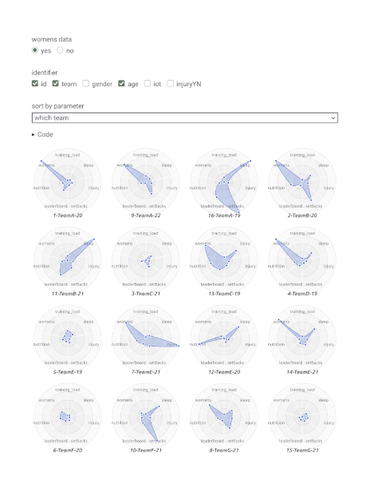{.lightbox}

## Word Frequency Analysis: I/We Ratio {.smaller}
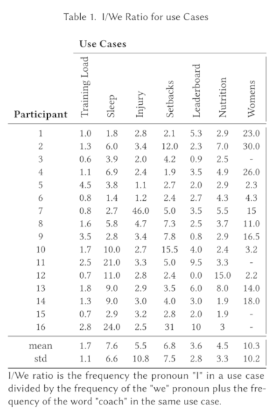{.lightbox}

## Reflexive Thematic Analysis: Gray Areas {.smaller}


**How do you feel about college teams using PTT data to manage athlete development setbacks?**

I feel like it could be a good thing. Uh, as long as it's not like abused. 

**Are there specific purposes or context that make it inappropriate or make it appropriate?** 

Um, I guess it just like kind of depends on the type of setback, like who it's related to. Uh, like training and everything. It, I think, is a little bit more appropriate because that's kind of what you're doing with the team. But if it's related to things outside of training, it's kind of like in a gray area.

**What do you mean by gray area?**

Because, like, the things kind of affect the training, and it could be technically part of the team's business because of that, but also it's kind of like part of your personal life.

## Reflexive Thematic Analysis: Finding the Narrative in *Injuries*, *Setbacks*, *Sleep*, *Nutrition*
* Responses to Questions about *Injuries* and *Setbacks* were Habits
* We ask about Habits in *Sleep* and *Nutrition*
* [College Athlete Common Personal Attributes: Trust, Self-belief]{.rn-fragment rn-type=strike-through rn-color=black}
* [Confirmation Bias]{.rn-fragment rn-type=strike-through rn-color=black}
* [Sentiment: Negative for Injuries, Positive for Habits]{.rn-fragment rn-type=strike-through rn-color=black}
* Set Up for Success

## CI Information Flows ffor *Sleep*, *Nutrition*

::: {layout-ncol=3}
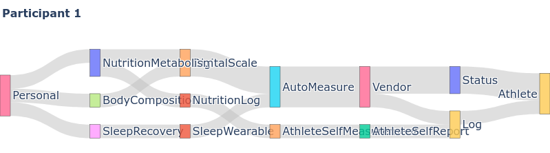

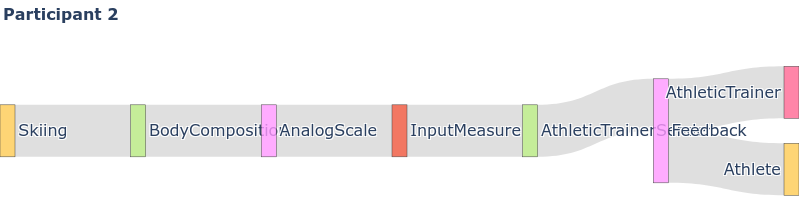

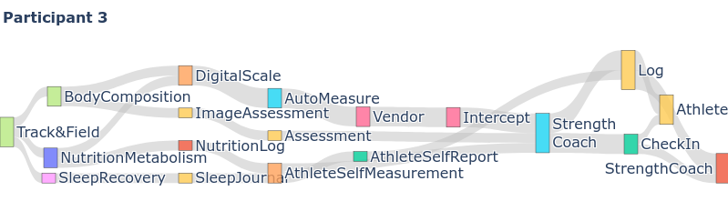

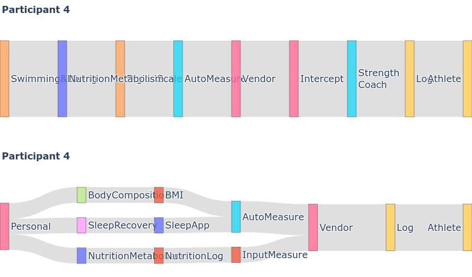

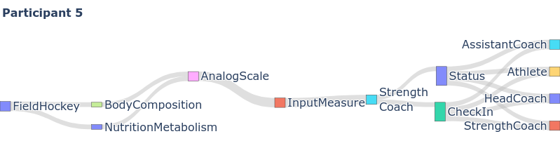

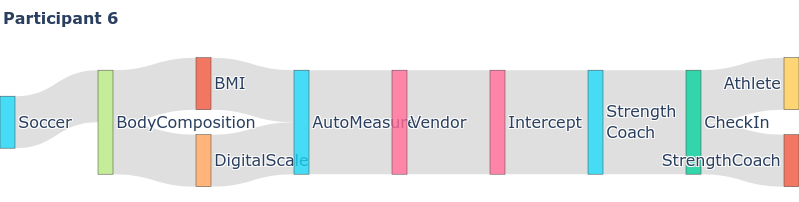

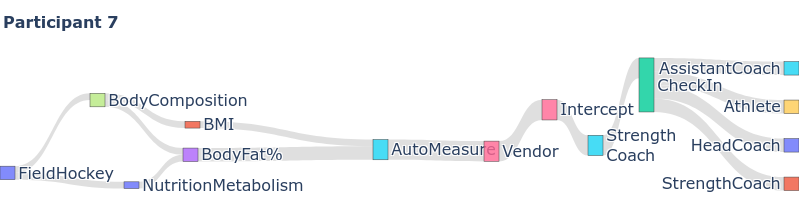

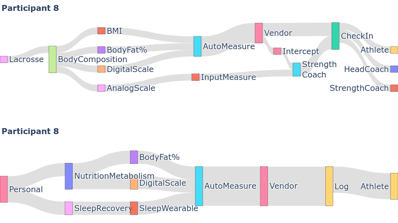

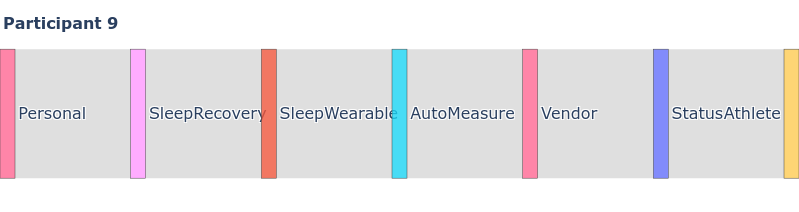

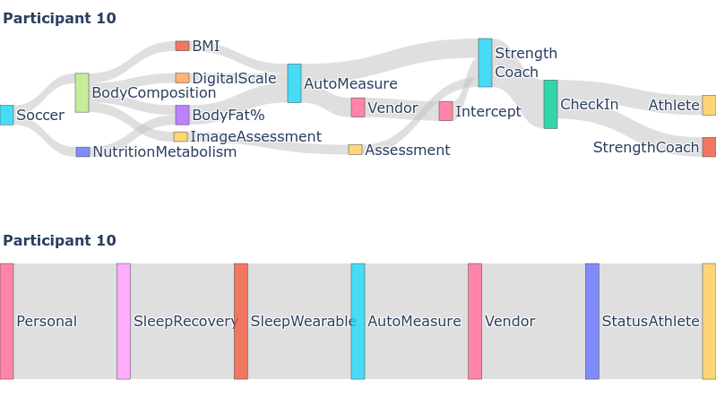

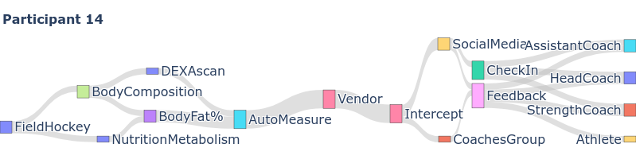

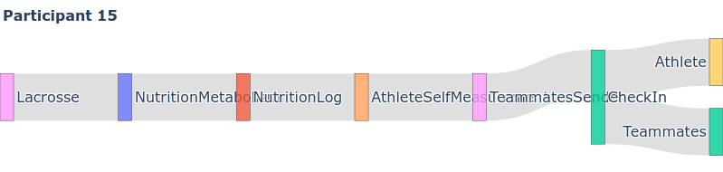

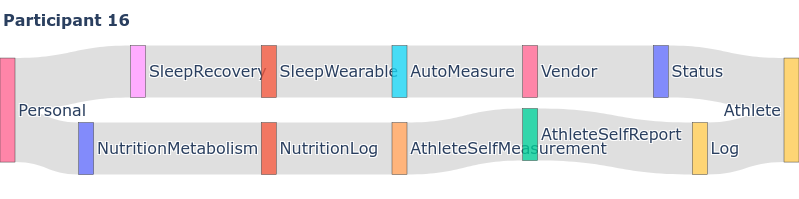

:::

## Current Work: Student-Athlete Surveys
* Vignettes as Pairwise-Comparisons
* Can I get useful information from student-athletes in 10 minutes or less?
* Focused Questions, Limited Combinations
* Elo Rankings and Hierarchical Bayesian Analysis

## Leaderboard Survey: CI Parameters {.smaller}

```{r}
#| echo: true
#| eval: true

library(jsonlite)

json <- '{
    "datatype": ["ongoing training", "ongoing results", "singular event"],
    "sender": ["strength coach","assistant coach","head coach"],
    "tp": ["skill development","competition cutoff","motivation"],
    "recipient": ["whole team"],
    "purpose": ["athlete development","team development","coaching assesment"]
}'

ci <- jsonlite::fromJSON(json)

```

## Leaderboard Survey: Comparison Combinations {.smaller}

```{r}
#| echo: true
#| eval: true
combinations <- expand.grid(ci$datatype,ci$sender,ci$tp,ci$recipient,ci$purpose)
names(combinations) <- c("datatype","sender","tp","recipient","purpose")
combinations

```

## Leaderboard Survey: Vignettes Template 

Athletes' results data from *datatype* on a leaderboard that is overseen by team's *sender* and shown to *recipient* in order to *tp* with the purpose of *purpose*

## Starting July 1, 2026

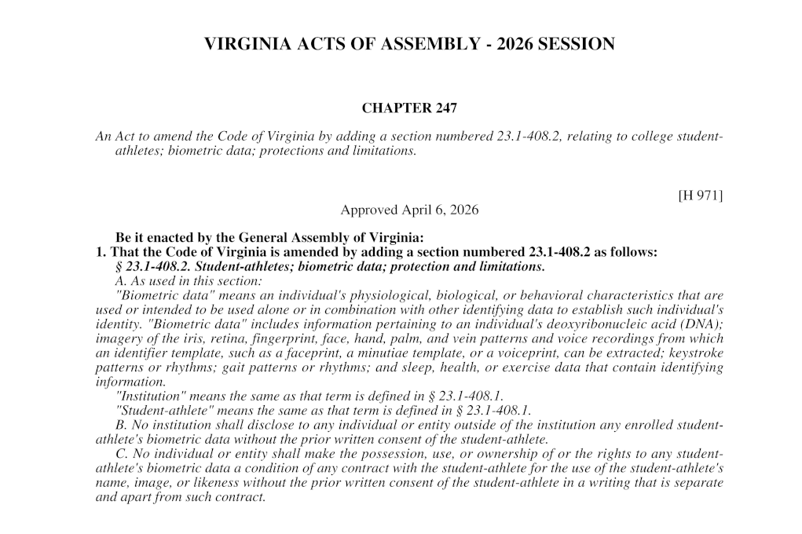

## Thank You

[Athletes Data Community Newsletter](https://newsletter.bradstenger.com) 

https://newsletter.bradstenger.com
