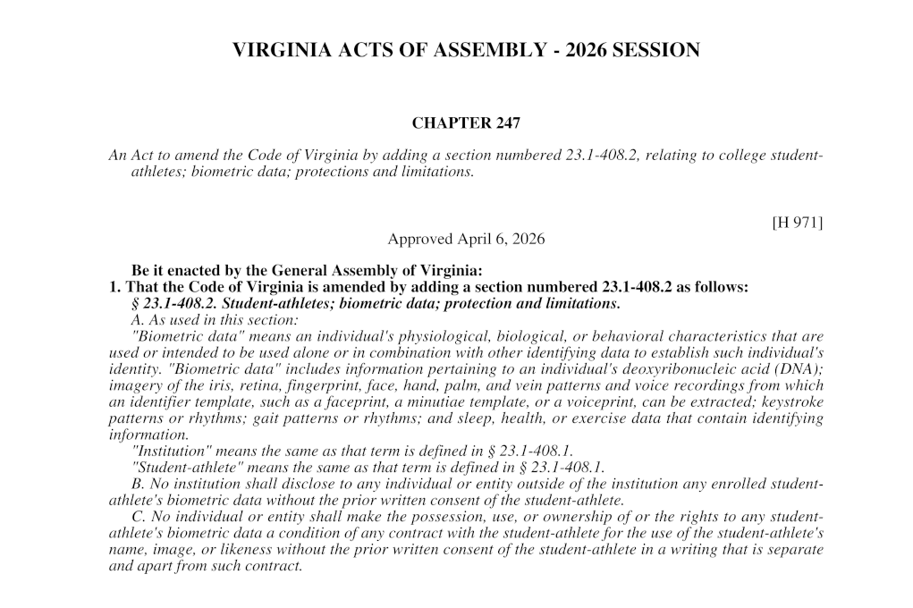
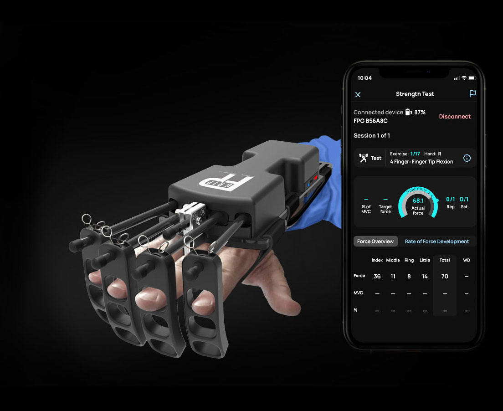

## Outline {.smaller}

* Duty of Care
* Data Exhaust
* Privacy
* Responsible Data Sharing
* Research Translation

## Duty of Care

In tort law, a duty of care is a legal obligation that is imposed on an individual, requiring adherence to a standard of reasonable care to avoid careless acts that could foreseeably harm others, and lead to claim in negligence.

* Broadly applicable to sports
* Deliberately injuring an opponent
* Safe equipment
* Coaches and training

## Data Exhaust

Data produced as a byproduct of an activity.

* Student data
* Citizen data
* Financial data
* Sports fan data
* Athlete data

##

* Duty of Care
* Data Exhaust

## Privacy

Someone's right to keep their personal matters and relationships secret.

* specifically, data and information privacy
* FERPA protects student information
* HIPAA protects health information (in clinical contexts)
* Vermont Data Privacy and Online Surveillance Act (VDPOSA) (S. 71 / Act 145) takes effect on January 1, 2028
* Biometric data privacy
* Expectation of Privacy, Agreements & Consent
* Privacy Enhancing Technology

## Athletes Biometric Data

##

* Duty of Care
* Data Exhaust
* Privacy

## Responsible Data Sharing

* It is possible to determine personal information by combining sources of de-identified data
* Differential privacy: noise infusion to mask personal identifiable information
* Athletes can have recognizeable biometric or biomechanical signatures in their data

##

* Duty of Care
* Data Exhaust
* Privacy
* Responsible Data Sharing

## Research Translation

Translational research is the process of converting basic scientific discoveries into practical applications.

* Field-based research
* Laboratory research
* Causal analysis
* Sports science research technology stack

## Example: FlexPro Grip

## Example: FlexPro Grip

* Duty of Care
* Data Exhaust
* Privacy
* Responsible Data Sharing
* Research Translation

## Thank You

Brad Stenger

jstenger@uvm.edu

Athletes Data Community Newsletter

https://newsletter.bradstenger.com