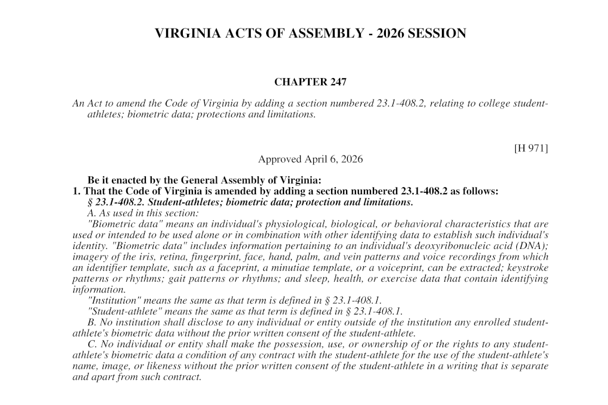
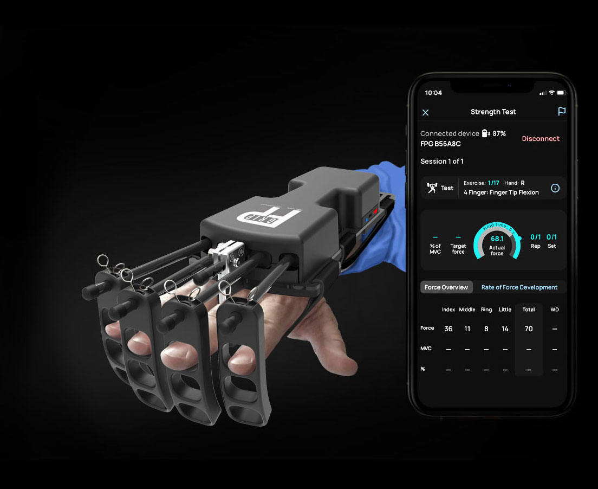

## Outline

* Privacy
  * Information Flows
  * Individual vs Social Identity
  * Abundant Niches
* Responsible Data Sharing
  * Technology Stack
  * Causal and Clinical Analysis: Evidence Requirements
* Research Translation

## Half of a Bridge

## Privacy {.smaller}

Someone's right to keep their personal matters and relationships secret.

* specifically, data and information privacy
* FERPA protects student information
* HIPAA protects health information (in clinical contexts)
* Biometric data privacy
* Expectation of Privacy, Notice & Consent Privacy Management
* Privacy Enhancing Technology
  * Differential Privacy
  * Synthetic Data

## Athletes Biometric Data

## Responsible Data Sharing {.smaller}

* It is possible to determine personal information by combining sources of de-identified data
* Differential privacy: noise infusion to mask personal identifiable information
* Athletes can have recognizeable biometric or biomechanical signatures in their data
* Example: Cycle Tracking

## Technology Stack {.smaller}

* Data Collection
  * Field-based research
  * Laboratory research
* "Extraction"
* JupyterHealth Collaboration Layer
  * Research Team use case
  * Personalization use case
  * AI use case

## Research Translation {.smaller}

Translational research is the process of converting basic scientific discoveries into practical applications.

* Causal analysis
* Power Laws
* Sports science research technology stack

## Example: FlexPro Grip

## Example: FlexPro Grip

* Privacy
* Responsible Data Sharing
* Research Translation

## Thank You

Brad Stenger

jstenger@uvm.edu

Athletes Data Community Newsletter

https://newsletter.bradstenger.com